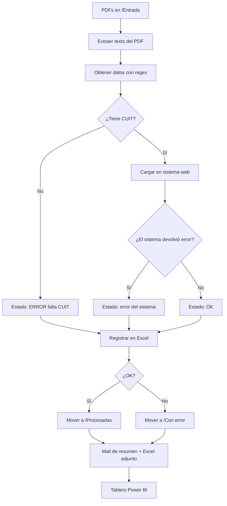
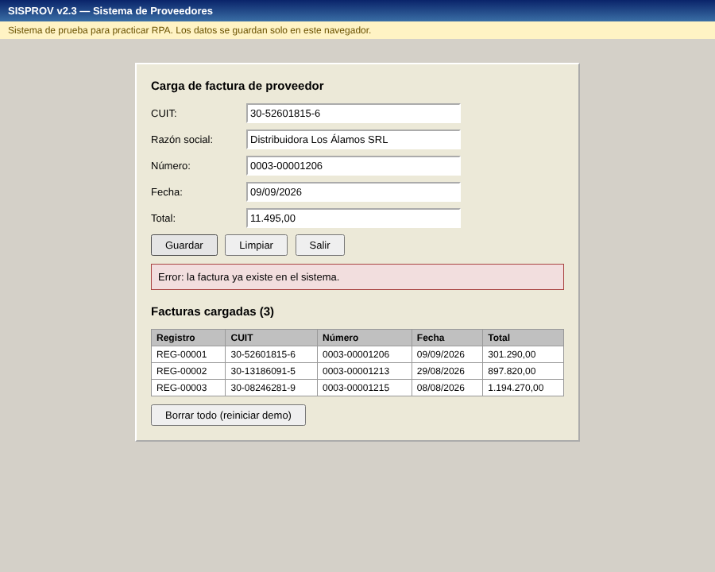
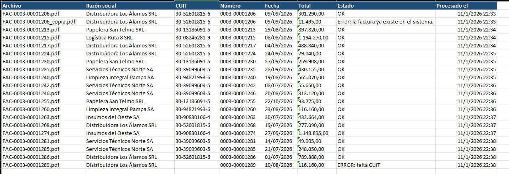
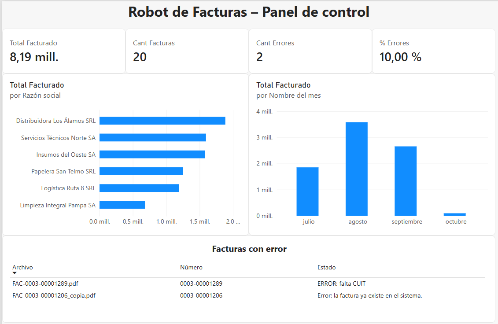

# 🤖 Robot RPA de Procesamiento de Facturas

Automatización de punta a punta del procesamiento de facturas de proveedores con **Power Automate Desktop**, **Excel** y **Power BI**.

El robot lee facturas en PDF, extrae sus datos, los carga en un sistema web sin API (como haría una persona), valida errores, registra todo en un Excel de control, ordena los archivos y envía un resumen por mail. Un tablero en Power BI muestra los resultados.

> ⚠️ Todos los datos son de prueba. Las facturas están marcadas "DOCUMENTO DE PRUEBA – SIN VALIDEZ FISCAL" y el sistema web es una demo local.

---

## 🎯 El problema

En muchas áreas de administración, alguien recibe facturas en PDF y las carga a mano en un sistema interno: copia el CUIT, el número, la fecha y el total, revisa si ya estaba cargada y archiva el PDF. Es lento, repetitivo y propenso a errores.

## ✅ La solución

Un robot que hace todo ese trabajo solo:

1. **Lee** todos los PDF de la carpeta `Entrada`.
2. **Extrae** razón social, CUIT, número, fecha y total con expresiones regulares.
3. **Valida**: si falta el CUIT, marca la factura con error sin cargarla.
4. **Carga** la factura en el sistema web (login, completar el formulario, guardar).
5. **Lee la respuesta** del sistema: si informa un error (por ejemplo, una factura duplicada), lo registra.
6. **Registra** cada factura en `Control_Facturas.xlsx` con su estado y la fecha de proceso.
7. **Mueve** el PDF a `Procesadas` o a `Con error`.
8. **Envía un mail** con el resumen (OK / con error) y el Excel adjunto.

## 🔄 Flujo



## 📊 Resultado de la corrida de prueba

| Facturas | OK | Con error | Errores detectados |
|---|---|---|---|
| 20 | 18 | 2 | 1 sin CUIT · 1 duplicada |

## 🛠️ Tecnologías

| Herramienta | Uso |
|---|---|
| **Power Automate Desktop** | Robot RPA: lectura de PDF, regex, automatización web, Excel, archivos y mail |
| **Chrome + extensión Power Automate** | Interacción con el sistema web |
| **Excel** | Registro de control |
| **SMTP (Gmail)** | Mail de resumen |
| **Power BI** | Tablero: Power Query (limpieza con configuración regional es-AR) y medidas DAX |
| **HTML / JavaScript** | Sistema web de prueba con login, validaciones y control de duplicados |

## 📈 Tablero en Power BI

- **Indicadores:** total facturado, cantidad de facturas, errores y % de errores.
- **Facturado por proveedor y por mes.**
- **Tabla de facturas con error** y su motivo.

Medidas DAX:

```DAX
Total Facturado = CALCULATE(SUM(Facturas[Total]), Facturas[Estado] = "OK")
Cant Facturas   = COUNTROWS(Facturas)
Cant Errores    = CALCULATE(COUNTROWS(Facturas), Facturas[Estado] <> "OK")
% Errores       = DIVIDE([Cant Errores], [Cant Facturas])
```

## 📸 Capturas

**Sistema web: el robot carga las facturas y el sistema rechaza la duplicada**



**Excel de control completado por el robot**



**Tablero en Power BI**



## 📁 Estructura

```
robot-facturas/
├── robot_facturas.txt        # Flujo de Power Automate Desktop
├── Panel_Facturas.pbix       # Tablero de Power BI
├── Control_Facturas.xlsx     # Excel de control (plantilla vacía; la completa el robot)
├── SistemaProveedores/
│   └── index.html            # Sistema web de prueba
├── Facturas/
│   ├── Entrada/              # Facturas a procesar
│   ├── Procesadas/
│   └── Con error/
└── capturas/
```

## ▶️ Cómo probarlo

1. Instalá **Power Automate Desktop** (gratis en Windows) y la extensión para Chrome. En `chrome://extensions` → Power Automate → activá **"Permitir el acceso a las URL de archivo"**.
2. Creá un flujo nuevo, abrí el archivo `robot_facturas.txt`, copiá todo su contenido y pegalo en el editor (Ctrl + V).
3. Ajustá las rutas de las carpetas a tu PC.
4. En la acción **Enviar correo electrónico**, poné tu mail y una **contraseña de aplicación** de Gmail.
5. Ejecutá el flujo.

Usuario del sistema web de prueba: `robot` · Contraseña: `demo123`.

## 👤 Autor

**Juan Cruz Molina**: desarrollador backend y RPA.
[LinkedIn](https://www.linkedin.com/in/juan-cruz-molina-824214199/) · [Portfolio](https://juan-cruz-molina-portfolio.netlify.app/)
